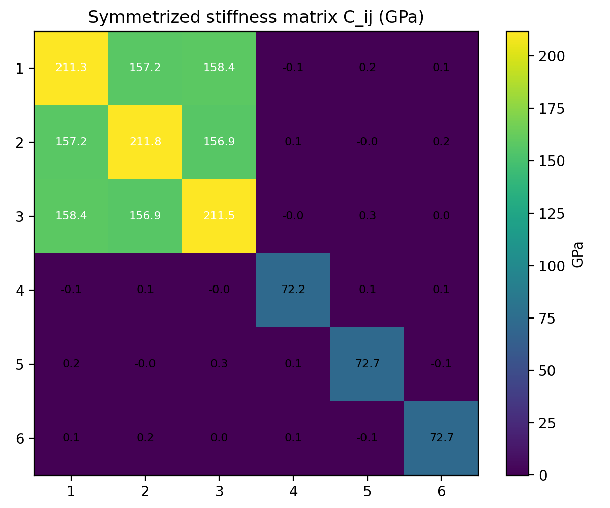

# Summary

Agentic workflows, i.e. software systems that use Large language models (LLMs) [@zhao2026survey], are increasingly being used to automate complex tasks, including software engineering, information retrieval, and scientific research. These developments have created new opportunities for AI systems that assist researchers with planning, computation, analysis, and validation. Here, we present URSA (Universal Research and Scientific Agent), an open-source framework for building modular and extensible AI agents specifically for scientific workflows. URSA enables researchers to compose domain-specific agents by integrating large language models with the appropriate scientific computational tools and knowledge, supporting both general-purpose scientific reasoning and specialized research applications.

# Statement of need

Scientific research increasingly requires AI systems that can integrate reasoning with external software, simulation codes, computational resources, and specialized literature [@boiko2023autonomous]. While existing agentic frameworks provide general-purpose planning and tool use, researchers often need specialized agents tailored to particular research questions.

URSA addresses this need through a collection of reusable core agents that implement common research capabilities such as hypothesis generation, planning, and execution. Furthermore, building on these core agents, URSA includes several specialized agents that demonstrate how the framework can be extended to research applications by integrating scientific computational tools and domain knowledge. These agents support tasks such as molecular dynamics simulations, large-scale numerical simulations, and optimization. Beyond serving as end-user applications, they also act as reference implementations that illustrate how new scientific agents can be developed by composing URSA's core reusable components. Importantly, URSA further provides multiple ways to deploy and orchestrate these agents. Researchers can interact with the framework through a command-line interface, web dashboard, Model Context Protocol (MCP), or Python API, while execution environments such as Agent Teams and Agent Symposia enable agents to collaborate or independently evaluate scientific problems.

# State of the field

Coding agents such as Claude Code [@claude_code] and Codex [@codex] assist with software development, including code generation and debugging. Scientific assistants such as AI Scientist [@lu2024ai], Co-Scientist [@gottweis2026accelerating], SciAgents [@ghafarollahi2025sciagents], Agent Laboratory [@schmidgall2025agent], and ChemCrow [@bran2024augmenting] demonstrate applications of LLMs to research. Frameworks for constructing agents provide complementary capabilities: LangGraph [@langgraph] supports stateful graph workflows and checkpointing, AutoGen [@autogen] provides abstractions for multi-agent conversations and teams, CrewAI [@crewai] organizes agents into crews and workflows, and smolagents [@smolagents] supports agents that act through generated code or tool calls. These frameworks provide general mechanisms on which scientific applications can be built.

URSA builds on LangGraph by packaging reusable research agents, agents for running scientific software and simulation codes, and interfaces for configuring and running scientific workflows. Its contributions include reusable agents for hypothesis generation, planning, simulation, and optimization, together with collaboration environments such as Agent Teams and Agent Symposia. Maintaining these components in a separate package allows domain-specific dependencies, examples, and user interfaces to evolve together while reusing LangGraph's orchestration infrastructure. Researchers can thus extend these implementations for their own scientific tools and tasks.

# Software design

URSA uses LangGraph [@langgraph] to express agent workflows through explicit states, nodes, and transitions, and to support checkpointing. This makes stages such as planning, review, execution, and error recovery independently configurable. 
Reusing this infrastructure reduces the orchestration code maintained within URSA, but requires agent implementations to follow LangGraph’s state model.
URSA supports multiple LLM providers through LangChain's chat-model interface. However, an agent's performance does vary with the selected model.

## Agent Framework

URSA provides reusable core agents and domain-specific agents that combine them with scientific tools and knowledge. The agents listed below illustrate these capabilities and are not an exhaustive list. Each agent has a configurable workspace for working files and command execution. Named agents maintain their persistent states in separate directories organized by group and agent name. Thread identifiers distinguish checkpointed conversations and checkpoints preserve the agent's state.

The `run_command` tool normally asks an LLM to assess a proposed shell command before executing it. The environment variable `URSA_SAFETY_LEVEL` is used to assess safety: `default` assesses commands with explicit trust assumptions for configured executables, agent-created files, and LaTeX operations; `low` focuses on destructive commands and high-concern data extraction; `trusted` supplies a generic trust statement without the command; and `none` or `yolo` bypasses assessment. LLM screening adds inference cost and can incorrectly accept or reject commands.

### Core Agents

Examples of core agents include:

* Planning Agent: Generates, reviews, and formalizes research plans as structured tasks.

* Execution Agent: Carries out tasks using tools for code execution, file operations, and shell commands, with additional tools available through the Model Context Protocol (MCP).

### Domain-Specific Agents

Examples of domain-specific agents include:

* Simulation Agent: Coordinates two Chat Agents for documentation acquisition and simulation setup, execution, debugging, and analysis.

* Optimization Agent: Formulates optimization problems, selects solvers, generates code, and checks results.

* LAMMPS Agent: Selects interatomic potentials, generates simulation inputs, runs the Large-scale Atomic/Molecular Massively Parallel Simulator (LAMMPS) [@thompson2022lammps], and supports error recovery and analysis [@somasundaram].

## User Interfaces

Users can interact with URSA through:

* The Command Line Interface (CLI): The CLI starts with:

    ```bash
    ursa --config config.yaml
    ```

    The configuration selects models and runtime options. Within the REPL, agent names prefixed with `#` route requests:

    ```text
    ursa> #plan Write a workflow for computing elastic constants
          using a molecular dynamics simulation.
    ursa> #execute Execute the plan.
    ```

* A Web Dashboard: The web dashboard provides a graphical interface and can be launched with `ursa-dashboard` after installing the optional dashboard dependencies.

* Python Interface: Python supports embedding agents in scripts and notebooks:

    ```python
    from langchain.chat_models import init_chat_model
    from langchain_core.messages import HumanMessage
    from ursa.agents import ExecutionAgent

    llm = init_chat_model(model="openai:gpt-5.4")
    agent = ExecutionAgent(
        llm=llm,
        workspace="./ursa-script-workspace",
    )

    result = agent.invoke({
        "messages": [
            HumanMessage(
                content=(
                    "Write and run a Python script that prints "
                    "the first 10 prime numbers."
                )
            )
        ],
    })
    print(result["messages"][-1].content)
    ```

## Agent Execution Environments

URSA provides collaboration environments for delegation and comparison of alternative scientific arguments. Examples of these environments include Agent Teams and Agent Symposia.

* Agent Teams: use a principal investigator agent to delegate tasks and combine results. The Execution Agent serves as the default coordinator, although users can substitute other agents equipped with delegation tools.

* Agent Symposia: let participants independently propose solutions, critique one another, and refine their responses before synthesis. Participants can bring different tools, models, and assumptions to the discussion.

# Research impact statement

URSA has been applied by the authors to scientific workflows, including inertial confinement fusion design and atomistic simulation. Developed at Los Alamos National Laboratory, it is distributed as open-source software to support use and contributions by the broader scientific community.

As one example, \autoref{fig:helios} shows the use of URSA in the design of inertial confinement fusion (ICF) capsules. In this workflow, URSA's hypothesizer and execution agents explored candidate designs to optimize neutron yield. More details of this application can be found in @grosskopf2025ursa.

![Comparison of URSA to Bayesian optimization (BO) for direct-drive ICF design, showing the running maximum neutron yield. URSA received a published double-shell ICF paper as literature context and a performance-target hint of $\log_{10}$ yield above 17; BO received neither. The initial Latin-hypercube evaluations for BO are omitted from the plot, and each URSA configuration was run once. Figure reproduced from @grosskopf2025ursa; the complete ICF workflow is not included in this repository.\label{fig:helios}](helios.png){width=70%}

As a second example, \autoref{fig:lammps} shows atomistic calculations performed by URSA's LAMMPS Agent [@somasundaram] for a high-entropy alloy [@george2019high]. Such calculations are commonly employed in computational materials science to predict material properties and guide the design of novel materials.

The simulation results shown in this figure were generated using the example script [`stiffness_tensor_of_hea.py`](https://github.com/lanl/ursa/blob/joss/examples/single_agent_examples/lammps_agent/stiffness_tensor_of_hea.py).

{width=70%}

# AI usage disclosure

This work is on AI-driven agentic workflows, so LLMs are invoked at multiple instances within URSA. For example, LLMs were involved in the generation of \autoref{fig:helios} and \autoref{fig:lammps}.
During the development of URSA, generative AI tools such as Codex and URSA itself were used to assist with implementing specific portions of the source code, including its documentation. While all major design and architectural decisions were made by the authors, generative AI tools were used to prototype new features, debug code, and write tests. 
For the writing of the manuscript, including its updates during the review process, generative AI tools were used for grammar and spell checks, cutting down the length of the manuscript, and for checking consistency of the manuscript with reviewer comments. All LLM-generated text, code, and documentation were critically reviewed by the authors for accuracy.

# Acknowledgements

This work was supported by the Laboratory Directed Research and Development program of Los Alamos National Laboratory under project number 20250638DI. This research used resources provided by the Los Alamos National Laboratory Institutional Computing Program, which is supported by the U.S. Department of Energy National Nuclear Security Administration under Contract No. 89233218CNA000001. This document has been approved for unlimited release, and was assigned LA-UR-26-27324.

# References
